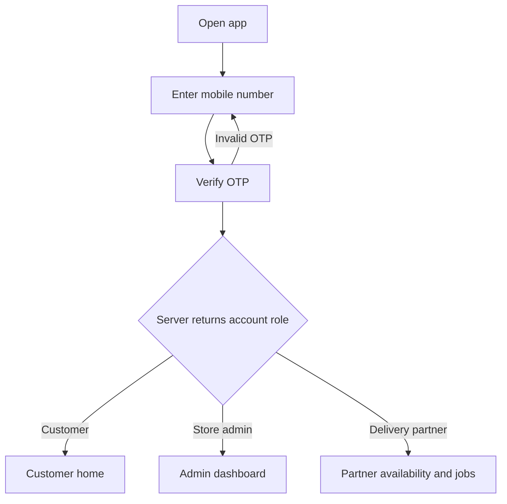
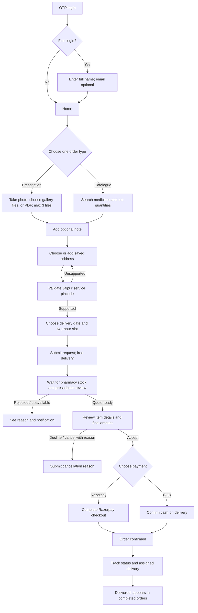
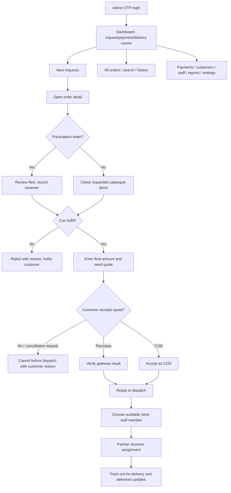
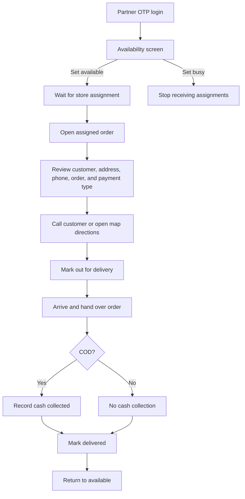

# Kamal Medical Hall app flows

This document translates the supplied PRD flowcharts and the client’s later decisions into role-specific app journeys. The PRD is product reference material; confirmed client decisions take precedence where they differ. The PRD proposes a web admin panel, while the client requests admin and partner experiences to open from the app after role-aware OTP login. Customer ordering is available on Android and iOS. These flows are API-backed in production; local mock data is for UI development only.

## Shared sign-in and role routing

The verified phone number is an account identifier, not an authorization rule. The backend assigns each account exactly one role and returns that role after OTP verification. The app routes from the authenticated role claim. A development-only role preview may help review the three experiences; it must never be present in production or replace server authorization.

## Customer journey

Prescription files and catalogue medicines cannot be combined. The cart asks before discarding the current order if the customer switches type. A customer can cancel in order details with a required reason, but only before the order goes out for delivery. The store has no refund policy; the app must not promise a refund. The completed-orders list contains completed orders; active tracking is reached from order notifications/details.

## Store admin journey

Admin screens: dashboard, new requests, order review, quote/rejection, payment status, assign partner, all orders, partner availability, customer list, reports, and store settings. Staff roster is limited to the store’s two or three delivery staff. Store settings include operating status and timings when supplied. Prescription approval should record the responsible pharmacist/admin identity, as required by the PRD.

## Delivery partner journey

Partner screens: login, availability, assignment notification, assigned-order detail, call/map actions, delivery status update, and COD cash summary. Live location tracking is Phase 2 in the PRD and is not part of this MVP flow.

## Order status model from the PRD

`Requested → Quoted → Accepted → Awaiting payment (Razorpay) / COD accepted → Ready to dispatch → Out for delivery → Delivered`

Terminal alternatives: `Rejected` (store reason required) and `Cancelled` (customer reason required or store-initiated reason). Customer cancellation is allowed only before out-for-delivery. No refund policy is provided, so no refund should be promised in customer-facing copy; payment-cancellation behavior requires backend/business handling before production.
